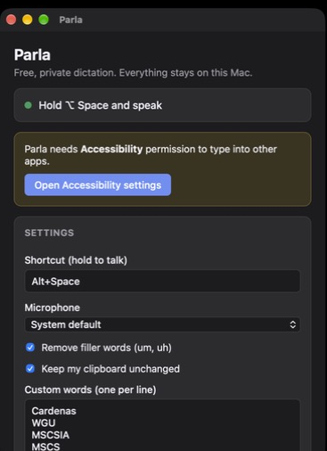

# Parla

Parla is a free, local, type-anywhere voice dictation app for macOS. Hold a
shortcut, speak, and your words are transcribed on-device and pasted into
whatever app has focus — an editor, a browser, a chat box, anywhere you can
type. By default nothing is sent to the cloud: there is no account, no
subscription, and the app makes no network calls once it is built. The one
exception is the optional AI cleanup, which is off unless you turn it on.



## What is included

- Hold-to-talk dictation from a global shortcut (default **⌥ Space**), with the
  transcript pasted at the cursor in any application.
- On-device speech recognition with whisper.cpp (Whisper large-v3-turbo),
  GPU-accelerated through Metal on Apple Silicon.
- A capture pipeline that skips silence, drops non-speech noise tags, and boosts
  quiet recordings so a distant microphone still transcribes cleanly.
- A custom-vocabulary prompt so names and jargon are spelled the way you mean
  them.
- Rule-based cleanup that removes filler words (um, uh) with no second AI model
  involved.
- Optional AI cleanup with Claude (off by default). When you turn it on and add
  your own Anthropic API key, the transcript text is sent to Claude to apply
  self-corrections ("Tuesday, no wait, Wednesday" becomes "Wednesday"), format
  spoken lists and fix punctuation. The key is stored in the macOS Keychain. If
  Claude cannot be reached or declines, Parla pastes the offline text instead.
- Clipboard-safe pasting: Parla restores whatever you had copied after it types,
  so dictation never clobbers your clipboard.
- An honest Accessibility check: if macOS has not granted permission yet, Parla
  leaves the text on the clipboard and explains exactly how to enable pasting.
- Settings for the shortcut, microphone, filler removal, clipboard behaviour,
  vocabulary and AI cleanup (model and optional workspace ID for
  organization-wide keys), saved as JSON in the app's config folder. The API
  key is never written to that file.

## Run locally

Prerequisites: Rust (stable; the crate uses the 2024 edition, so Rust 1.85+),
Node.js 22+, and the Tauri prerequisites for macOS (Xcode Command Line Tools).

Download the speech model once (~550 MB; it is not stored in git):

```
./scripts/fetch-model.sh
```

Run the app in development:

```
npm install
npm run tauri dev
```

Build a signed app and install it to `/Applications` (so macOS keeps the
Microphone and Accessibility permissions across rebuilds):

```
./scripts/build-local.sh
```

On first launch, grant **Microphone** and **Accessibility** when asked.

## Architecture

| Area | Technology | Purpose |
| --- | --- | --- |
| Desktop shell | Tauri 2 + Rust | Window, global shortcut, app lifecycle |
| Interface | React + TypeScript + Vite | Status and settings window |
| Audio capture | cpal | Microphone capture on its own thread, mono + 16 kHz resample |
| Speech-to-text | whisper-rs (whisper.cpp) + Metal | On-device transcription |
| Text output | enigo + arboard | Paste at the cursor, then restore the clipboard |
| Cleanup | Rust, rule-based | Filler and noise removal — no AI model |
| AI cleanup (optional) | reqwest + Anthropic Messages API | Off by default; text-only polish by Claude |

The speech model is downloaded at build time and bundled into the app. See
[docs/architecture.md](docs/architecture.md) for how the pieces fit together.

## Testing

```
cd src-tauri
cargo test --release
```

The suite covers the audio, cleanup and vocabulary helpers, plus an end-to-end
test that transcribes a short reference recording and checks the result. The
end-to-end test is skipped automatically if the model has not been downloaded.

## Versioning

This repository uses Git tags for meaningful milestones. The first release is
`v1.0.0`.

## Privacy and safety

Parla runs entirely on your Mac unless you turn on AI cleanup. Audio is always
captured and transcribed locally, and by default the text is cleaned up locally
too; apart from the one-time model download at build time, the app makes no
network calls. There is no account and no telemetry.

AI cleanup is off by default. If you turn it on, each dictation's transcript
text (never audio) is sent over HTTPS to Anthropic's API, along with your
custom words and the name of the app you are typing into, using your own API
key. Anthropic's data policies apply to that text. Your key is kept in the
macOS Keychain, not in the settings file. Turn the setting off and Parla is
fully offline again.

Do not add secrets, API keys or personal data to the repository.

## Credits

Parla is original code. Like every dictation app, it builds on open-source
components for the hard parts, used under their own licenses:

- [whisper.cpp](https://github.com/ggml-org/whisper.cpp) and OpenAI's
  [Whisper](https://github.com/openai/whisper) model for speech recognition.
- [Tauri](https://tauri.app), [cpal](https://github.com/RustAudio/cpal),
  [enigo](https://github.com/enigo-rs/enigo), and
  [arboard](https://github.com/1Password/arboard).

## License

MIT. See [LICENSE](LICENSE).
